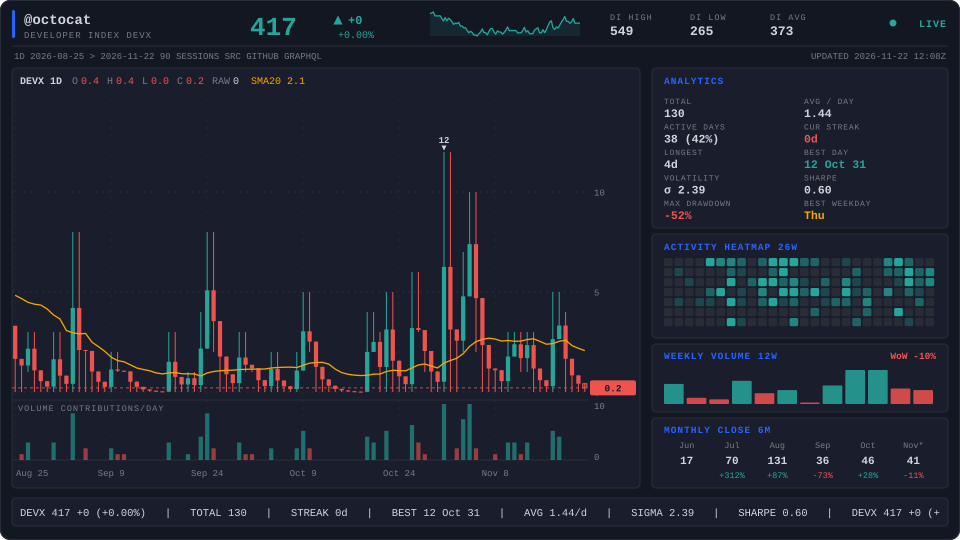

<div align="center">

# gh-trading-terminal

**Your GitHub contributions as a Bloomberg / TradingView-style terminal.**
Candlesticks, volume, heatmap, streaks, and a fictional Developer Index, as a pure SVG for your profile README.

[](https://github.com/hanzlabaig-dev/gh-trading-terminal/actions/workflows/ci.yml)
 


<sub>Preview uses synthetic sample data. Yours uses your real contribution calendar.</sub>

</div>

## Setup in 3 steps (no server, no hosting)

1. **Add a workflow** to your profile repo (`USERNAME/USERNAME`) at `.github/workflows/terminal.yml`:

```yaml
name: Update trading terminal
on:
  schedule: [{ cron: '17 */6 * * *' }]
  workflow_dispatch:
permissions:
  contents: write
jobs:
  terminal:
    runs-on: ubuntu-latest
    steps:
      - uses: actions/checkout@v4
      - uses: hanzlabaig-dev/gh-trading-terminal@v1
        with:
          days: 90
          theme: tradingview
          token: ${{ secrets.GH_PAT || secrets.GITHUB_TOKEN }}
```

2. **Run it once**: Actions tab > *Update trading terminal* > *Run workflow*. It commits `assets/terminal-dark.svg` and `assets/terminal-light.svg`.
3. **Embed it** in your profile `README.md`:

```md
<picture>
  <source media="(prefers-color-scheme: light)" srcset="assets/terminal-light.svg">
  
</picture>
```

Private contributions: create a token with `read:user`, save it as repo secret `GH_PAT`, and enable "Private contributions" in your GitHub profile settings. If the default token is rejected, use `GH_PAT`.

## Action inputs

| input | default | notes |
|---|---|---|
| `username` | repo owner | any GitHub login |
| `days` | `90` | 14-730 |
| `theme` / `light-theme` | `tradingview` / `light` | `tradingview`, `bloomberg`, `midnight`, `light` |
| `output-dir` | `assets` | where SVGs are written |
| `show` | all but `bands` | `stats,heatmap,weekly,monthly,volume,tape,sma,bands` or `all` |
| `extra-args` | | any CLI flag, e.g. `--colorblind true --hide tape --up #00ff88` |
| `commit` | `true` | set `false` to handle commits yourself |

## Other ways to run it

**CLI** (Node 18.3+, zero dependencies):

```
git clone https://github.com/hanzlabaig-dev/gh-trading-terminal && cd gh-trading-terminal
npm test
npm run demo                                   # synthetic data, no token
GITHUB_TOKEN=xxx node src/cli.js --user YOU --from 2026-01-01 --to 2026-11-22 --theme bloomberg --out terminal.svg
```

Flags: `--user --days --from --to --theme --show --hide --animate false --colorblind true --up --down --bg --alpha --demo --out`.

**Live URL (optional):** deploy to Vercel, set `GITHUB_TOKEN`, then use
`https://YOUR-APP.vercel.app/api/terminal?user=YOU&theme=bloomberg&days=120` as the image URL (`api/terminal.js`, cached 1h).

## How the numbers work

GitHub only exposes **daily** totals, so real intraday OHLC does not exist. Candles are a deterministic mapping of your real counts:

- `level(t) = level(t-1) + alpha * (count(t) - level(t-1))`: an EMA of activity, the "price".
- **Open** = previous level, **Close** = new level. Green when the day beat the running level, red when it didn't.
- **High / Low** = max / min of open, close, today's count and yesterday's count.
- **Volume** = raw contributions per day (huge spikes are clipped and marked).
- **Developer Index (0-1000)** = rolling 28-day blend: 35% active-day ratio, 25% intensity, 20% streak (cap 14d), 20% stability. Fictional but reproducible.
- **Sharpe** = mean / sigma of daily counts. **Max drawdown** = worst peak-to-trough fall of the Developer Index.
- The current UTC day is drawn as a pulsing translucent candle (session still open).

## Limits and notes

- GraphQL allows under a year per query, so longer ranges are chunked automatically.
- GitHub's image proxy blocks scripts, CSS and web fonts. The SVG uses plain attributes, system monospace fonts and SMIL only, and works in any `` tag.
- Images are cached by GitHub, so changes can take a few minutes to show. The SVG prints its own `UPDATED` time.
- Commits made by the Action bot do not count as your contributions.

## Contributing

PRs welcome: new themes live in `src/themes.js`, layout in `src/render.js`, metrics in `src/analytics.js`. Run `npm test` before opening a PR.

MIT License
